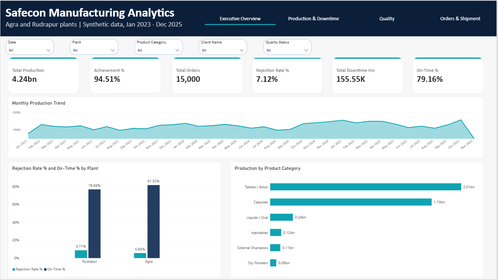
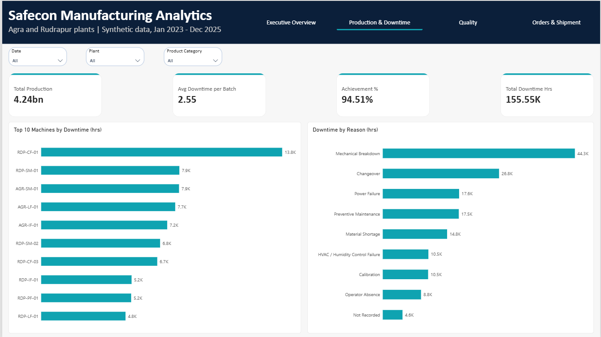
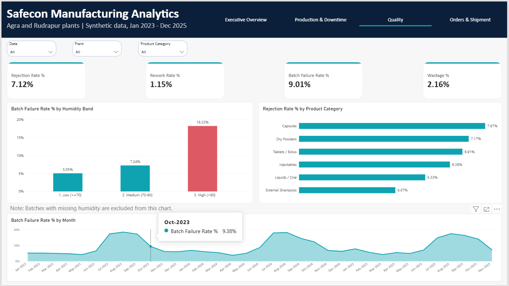
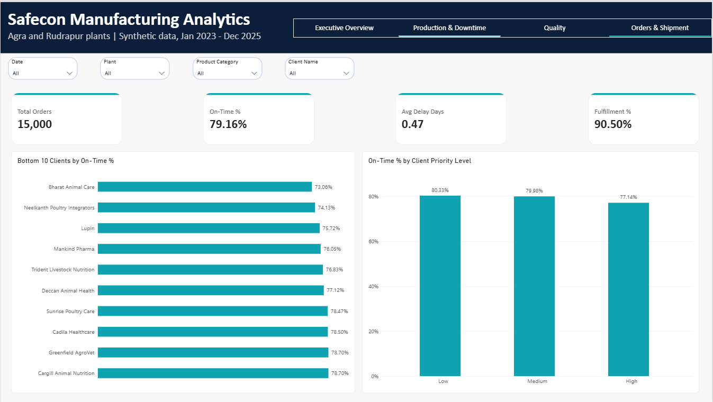

# Safecon Manufacturing Operations & Order Fulfillment Analytics

**A note about the data:** everything in this project is synthetic (simulated). I did not have access to real company data, so I worked with a made-up dataset built around a veterinary pharma manufacturing scenario. It is not real or confidential data of Safecon Lifesciences or any client named here. The company and client names are only labels for the scenario, and none of the numbers say anything about the real companies.

## What this project is about

I built this project to practise a complete analytics workflow on a business problem: cleaning messy data, analysing it in SQL, modelling it in Power BI and turning the numbers into recommendations.

The scenario is a B2B contract manufacturer of animal healthcare products with two plants, Agra (Sikandra, UP) and Rudrapur (Uttarakhand). Management wants to know what is hurting production efficiency, product quality and order delivery across the two plants. In particular I wanted to find the main sources of downtime, quality failures, production loss and late shipments.

I started with one idea to test: high humidity (above 80%) and long machine downtime might be linked to more quality failures, more rework and wastage, and late deliveries. I treat the results as associations, not proof of cause, because this is simulated data and I could not control for everything.

## About the data

The data covers January 2023 to December 2025, and has two fact tables and four dimension tables.

| Table | Rows | What it holds |
|---|---|---|
| Fact_Production | 60,973 | One batch on one machine (27 columns). The raw file had 61,216 rows, and 243 were exact duplicates |
| Fact_Orders | 15,000 | One B2B order for one product, client and plant. The raw file had 15,045 rows, and 45 were duplicates |
| Dim_Client | 28 | Client type, region, priority level |
| Dim_Product | 60 | Category, dosage form, standard batch size |
| Dim_Machine | 40 | Plant, machine type, installation year |
| Dim_Date | 1,096 | Calendar table |

Production dates run from 2023-01-05 to 2025-11-25, so November 2025 is a partial month and looks low in the charts. The column meanings are in `data/Data_Dictionary.md`.

I used one rule throughout: Accepted quantity = Produced - Rejected - Rework. Wastage is counted separately as material loss.

The dataset is synthetic. I defined the business scenario, the tables and the kind of problems I wanted in the data, and the data itself was generated with AI help. I then did the cleaning, SQL analysis, data model and dashboard myself. The raw files were deliberately messy (wrong spellings, mixed date formats, duplicates, impossible values), which gave me real cleaning work to do.

## Tools

Excel for the first inspection and cleaning, MySQL Workbench for import and analysis, Power BI Desktop for the data model and dashboard, and GitHub to publish everything.

## What I did

**Cleaning production data in Excel.** The raw file had 12 different spellings of the plant name, three date formats (about 1,400 dates were being misread by Excel), 243 duplicates, and impossible values in humidity, temperature, downtime and quantities. I standardised the plant names, looked up client names from the client table, removed the duplicates, and blanked out the impossible values instead of guessing replacements. Missing humidity is not filled in. Those batches go into an "Unknown" band. 644 rows where Accepted + Rejected + Rework did not add up to Produced are kept, but flagged with `Qty_Valid = 0` and left out of quantity KPIs.

**Loading and cleaning orders in SQL.** I loaded the raw orders file into an all-text staging table first, then cleaned it into the final table. That meant parsing three date formats, fixing 8 plant spellings and 6 shipment status labels, and removing 45 duplicate orders. The raw `Delay_Days` column turned out to be unreliable (152 rows did not match their own dates), so I calculated `Delay_Days_Clean` from the dates and added `Date_Valid` and `Qty_Valid` flags.

**SQL analysis.** I worked through 15 analysis queries, from simple totals by plant to joins, CASE WHEN bands for humidity and downtime, CTEs, `LAG()` for month-over-month change and `RANK()` inside each plant. I kept production and orders in separate CTEs so the two tables are never joined row to row, which would double count. I wrote the first queries myself, and for the rest I ran each one, checked the result against the number I expected, and practised until I could explain every line. The setup steps, cleaning scripts, queries and result screenshots are in `documentation/Importing_data.docx`.

**Power BI.** I built a star schema. The two fact tables are linked only through shared dimensions (client, product, machine, date and a small plant table), and never directly to each other. I wrote the DAX measures and built a four-page dashboard. Every number on the dashboard was checked against the matching SQL result.

## Problems I ran into

- The Workbench import wizard loaded only 58,063 rows, and `LOAD DATA` failed with a `local_infile` error. I fixed it by turning on `local_infile`, using forward slashes in file paths, and importing through a staging table.
- My own Excel export had date-format problems, so for the SQL import I used a cleaned CSV that follows the same cleaning decisions I made in Excel.
- In Power BI, the orders table showed the same numbers for both plants. I had used the Plant column from the wrong table. Switching to the right one fixed it.
- My Total Wastage measure gave 2.12% instead of 2.09% because I forgot the `Qty_Valid = 1` filter. I only noticed because I compared it with the SQL result.

## Dashboard






The four pages are Executive Overview, Production & Downtime, Quality, and Orders & Shipment. In Power BI Desktop the page buttons need Ctrl + click.

## KPIs

| KPI | How it is calculated | Value (all data) |
|---|---|---|
| Total Production | Sum of produced quantity (valid rows) | 4,236,587,838 |
| Achievement % | Produced / Planned | 94.51% |
| Rejection Rate % | Rejected / Produced | 7.12% |
| Rework Rate % | Rework / Produced | 1.15% |
| Wastage % | Wastage / Produced | 2.16% |
| Batch Failure Rate % | Failed batches / valid batches | 9.01% |
| Total Downtime Hours | Sum of downtime hours | 155,551.85 |
| Total Orders | Count of orders | 15,000 |
| On-Time % | Average on-time flag (orders with valid dates) | 79.16% |
| Fulfillment % | Shipped / Ordered (valid rows) | 90.50% |
| Avg Delay Days | Average clean delay days | 0.47 |

## What I found

**Rudrapur is behind Agra on almost everything.** Rejection is 8.71% against 5.60%, batch failure 10.76% against 7.34%, on-time delivery 76.68% against 81.53%, and fulfillment 88.04% against 92.91%. Rudrapur also lost about 11,200 more hours to downtime even though it ran fewer batches.

**High humidity goes with much worse quality.** Above 80% humidity the batch failure rate is 18.23%, compared with 5.05% when humidity is 70% or below. Rejection goes from 4.39% to 13.45%. The same pattern shows up in both plants (Agra 4.48% to 16.13%, Rudrapur 5.82% to 19.71%), so it is not just because of the plant mix.

**Quality drops every July to October.** Failure is around 14-18% in those months every year and about 4-9% in the rest. This fits the humidity pattern.

**Long downtime goes with lower output and quality.** Batches with more than 5 hours of downtime reach 82.39% of plan, against 98.78% for batches with none, and their failure rate is 17.18% against 7.08%. It could also work the other way, since failing batches may cause stoppages.

**A few machines and reasons explain most downtime.** One Rudrapur machine, RDP-CF-01, has 13,824 hours, about 1.7 times the next machine in that plant. Mechanical breakdown (28.50%) and changeover (17.25%) together make up 45.75% of all downtime.

**Orders with more downtime ship later.** On-time delivery falls from 95.24% for orders with no downtime to 58.29% for orders averaging more than 5 hours per batch. I did not separate this by plant, so part of it may just be the plant effect.

**Delivery differs by client, and high-priority clients do worst.** On-time % ranges from 73.06% to 87.76% across clients. High-priority clients have the lowest on-time rate (77.14%, against 80.33% for low priority), and this holds in both plants.

## What I would suggest

1. Look at Rudrapur first, starting with a maintenance review of machine RDP-CF-01.
2. Watch humidity closely and add extra quality checks when it goes above 80%, especially from July to October.
3. Focus maintenance on breakdowns, and make recording a downtime reason compulsory (2.93% of downtime has no reason).
4. Check the scheduling for high-priority clients, since they currently get the weakest on-time delivery.
5. Before spending money, test the humidity and downtime links more carefully, for example machine by machine.

## Limitations

- The data is synthetic, so the findings describe the simulated scenario and not the real business.
- These are associations. Plant, machine and product mix were not fully controlled for.
- Downtime is used as a stand-in for production delay because there is no direct delay column.
- Batches with missing humidity are left out of the humidity chart.
- November 2025 and January 2023 are partial months.
- On-time and delay figures use only orders with valid dates, and fulfillment uses only orders with valid quantities.

## What I would add next

- A Python notebook for exploratory analysis and for cross-checking the SQL results
- Pivot tables and charts in Excel
- A check of the downtime and delay link separately for each plant

## Repository structure

```
Safecon-Manufacturing-Analytics/
├── README.md
├── data/
│   ├── raw/
│   ├── cleaned/
│   └── Data_Dictionary.md
├── sql/
│   ├── 01_setup_and_import.sql
│   └── 02_analysis_queries.sql
├── powerbi/
│   └── Safecon_Operations_Dashboard.pbix
├── screenshots/
└── documentation/
```

To run the SQL import yourself, replace `<path>` in the `LOAD DATA LOCAL INFILE` lines with your own folder (use forward slashes) and turn on `local_infile`.
